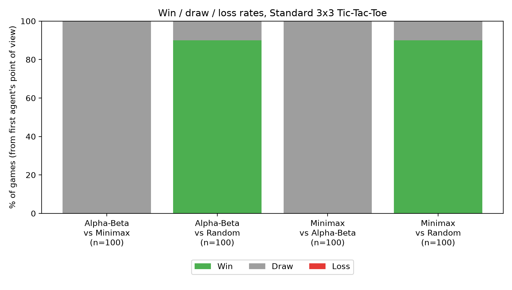
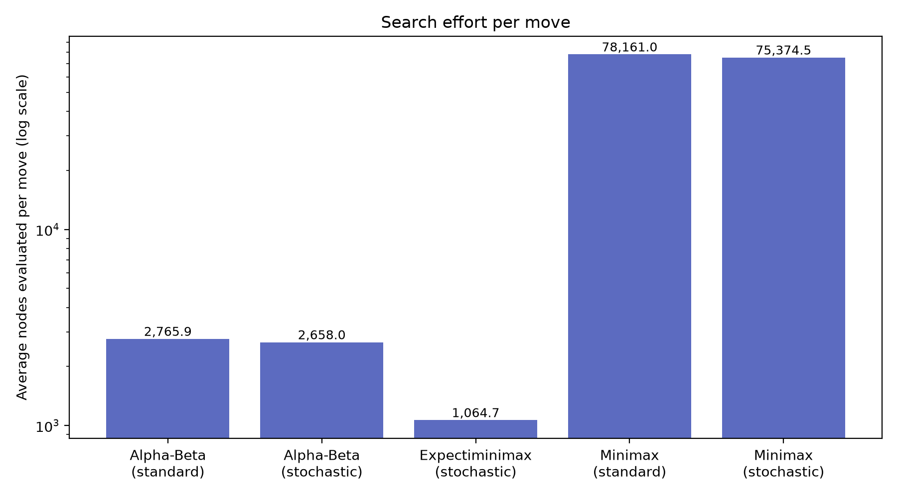
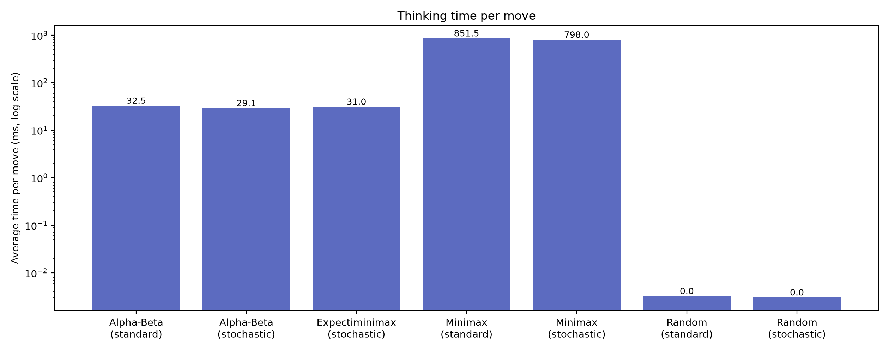
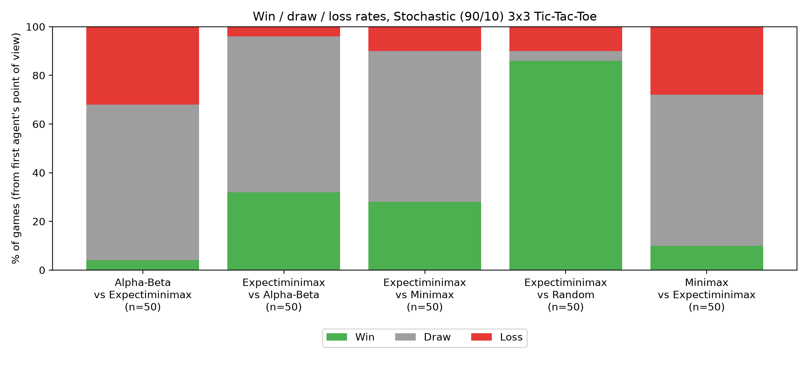
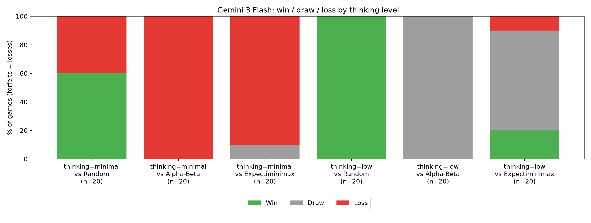
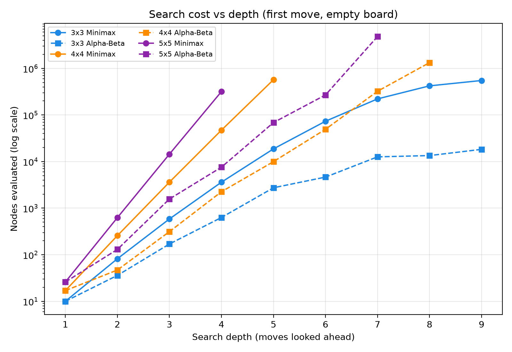
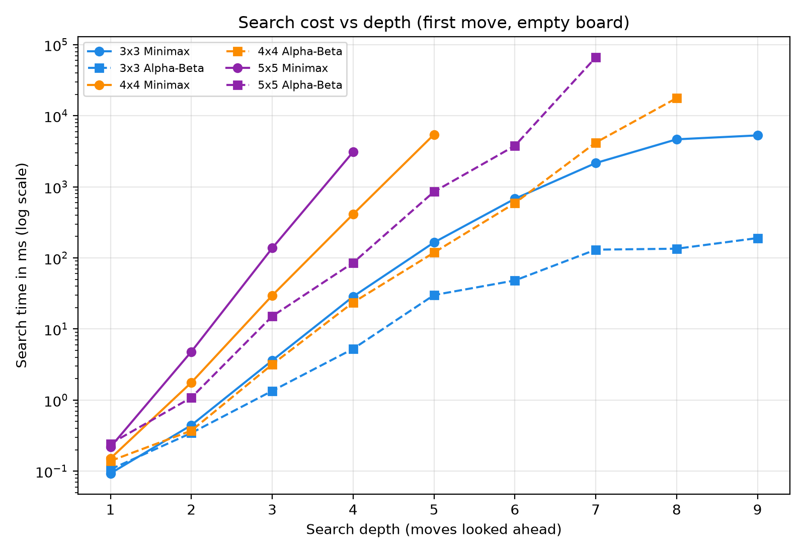
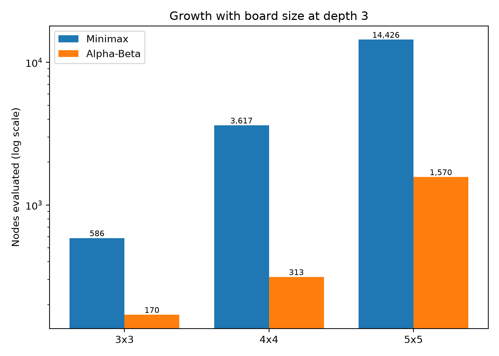

# *CP468 – Multi-Agent Decision Making in Games | Final report | Standard 3×3 Tic-Tac-Toe*

| | |
|---|---|
| **Course** | CP468 – Artificial Intelligence |
| **Project** | Multi-Agent Decision Making in Games |
| **Group** | Group 1 |
| **Members** | Adom, Michelle (ID: ________) · Couto, Marie (ID: 169078846) · Glennie, Robert (ID: ________) · Mongeon, Ethan (ID: ________) · Rempel, Devon (ID: ________) |
| **Date** | November 25, 2026 |

## Contents

1. Design Choices
2. Minimax
3. Alpha-Beta Pruning
4. Minimax and Alpha-Beta Performance Comparison
5. Expectiminimax
6. Gemini API Integration
7. Testing Results
8. Scalability Analysis
9. Conclusions

## Design Choices

#### Architecture

The project is split into layers that depend only on the layer below, so every algorithm can play any game variant and every agent can face any other agent.

| Layer | Location | Role |
|---|---|---|
| Game environment | `game/` | `Board` (immutable N×N state, legal moves, win/draw detection, utility) and `stochastic.py` (chance mechanics) |
| Algorithms | `algorithms/` | Minimax, Alpha-Beta, Expectiminimax, `line_heuristic`, `SearchStats` |
| Agents | `agents/` | Common `choose_move(state)` interface for Human, Random, Minimax, Alpha-Beta, Expectiminimax and Gemini |
| API | `api/` | Gemini HTTP client and prompt builder |
| Interface | `ui/` | Text interface (`cli.py`) and game-tree renderer (`tree_viz.py`) |
| Evaluation | `evaluation/` | Benchmarks, metrics, scalability study, plots |

`main.py` supports both required modes: **Human vs AI** and **AI vs AI**.

#### Data structures

- **Board state:** a frozen dataclass holding a flat tuple of `size × size` cells (`'X'`, `'O'` or `None`), the player to move, the board size and the winning-line length (`win_length`, default = board size). A flat tuple is compact and hashable, so it can be used directly as a cache key. `apply_move` returns a *new* board, so the search never has to undo moves and cannot corrupt a parent state.
- **Winning lines:** `heuristics._windows(size, k)` precomputes every run of `k` cells (rows, columns, both diagonals) once per board size and caches it, so heuristic evaluation is a simple loop over index tuples.
- **Search statistics:** `SearchStats` counts nodes evaluated, leaf evaluations, cutoffs, skipped branches and elapsed time (`time.perf_counter`) for every search.
- **Search tree:** when `record_tree` is on, each visited and each pruned node is stored as a `TreeNode` (move, value, α, β, pruned flag) so `render_tree()` can display the search.

#### Optimization techniques

| Technique | Where | Effect |
|---|---|---|
| Alpha-Beta cutoffs | `alphabeta.py` | Skips branches that cannot change the decision (96.7% fewer nodes on the empty 3×3 board) |
| Memoization (`lru_cache`) | `expectiminimax.py` | Each distinct position is evaluated once, since many move orders reach the same board |
| Depth limit + heuristic | `alphabeta.py`, `heuristics.py` | Makes 4×4 and 5×5 boards searchable |
| Move ordering hook | `alphabeta.py` (`order_moves`) | Lets callers try likely-best moves first to increase cutoffs |
| Tree recording off by default | `alphabeta.py` | Avoids memory overhead unless visualization is requested |

#### Heuristic evaluation

For depth-limited search, `line_heuristic(state, player)` scores non-terminal positions. Every winning line that is still open for only one side contributes `(marks / k)²` to that side's score, where `k` is the winning line length, so lines that are nearly complete count much more than lines with a single mark. The sum is divided by the number of lines, which keeps the score strictly between −1 and +1, so an estimate can never outrank a real win (+1) or a real loss (−1).

#### Stochastic variant

To give Expectiminimax a genuine chance element, we defined a *slippery-move* variant of Tic-Tac-Toe: a player chooses an intended empty square, and with probability **p = 0.90** the mark lands there; with probability **0.10** it lands on one of the *other* empty squares, chosen uniformly. When only one square is empty the move is certain. Utilities are unchanged (+1 / 0 / −1).

## Minimax

#### Overview

Minimax is an adversarial search algorithm for deterministic, two-player games. We used it to choose moves in standard 3×3 Tic-Tac-Toe. The algorithm assumes both players make optimal decisions: the AI is the maximizing player (**MAX**), and its opponent is the minimizing player (**MIN**).

The algorithm evaluates completed games using utility values from the AI's perspective:

| Game result | Utility |
|---|---:|
| AI wins | +1 |
| Draw | 0 |
| AI loses | −1 |

MAX chooses the highest possible value, while MIN chooses the lowest. By recursively considering the opponent's responses, Minimax identifies the move with the best outcome.

#### Implementation

Our Python implementation uses two functions in `algorithms/minimax.py`:

- `minimax(state, player, is_max, stats)` recursively evaluates possible future moves and alternates between MAX and MIN.
- `minimax_search(state, player)` evaluates each legal move and returns the best move, its utility score, and search statistics.

The `MinimaxAgent` class in `agents/minimax_agent.py` uses `choose_move(state)` so that the main game can request a move from the algorithm.

Instead of implementing Tic-Tac-Toe rules a second time, Minimax uses the game's shared state functions: `is_terminal()` to detect game endings, `get_legal_moves()` to list available moves, `apply_move()` to create the next state, and `utility(player)` to score a terminal state. The project’s `SearchStats` class records the number of visited nodes, terminal evaluations, and elapsed search time.

#### Pseudocode

```text
MINIMAX(state, player, is_max):
    if state is terminal:
        return utility(state, player)

    best = -infinity if is_max else +infinity

    for each legal move:
        next_state = apply_move(state, move)
        score = MINIMAX(next_state, player, not is_max)

        if is_max:
            best = max(best, score)
        else:
            best = min(best, score)

    return best

MINIMAX_SEARCH(state, player):
    best_move = None
    best_score = -infinity

    for each legal move:
        next_state = apply_move(state, move)
        score = MINIMAX(next_state, player, False)

        if score > best_score:
            best_score = score
            best_move = move

    return best_move, best_score
```

#### Complexity

The conventional worst-case time complexity of Minimax is **O(n^m)**, where **n** is the branching factor (available moves) and **m** is the maximum search depth. Standard 3×3 Tic-Tac-Toe has at most nine moves from an empty board, with fewer available after each turn. Our implementation explores all legal continuations without pruning, so early-game searches are more expensive than late-game searches.

The recursion uses **O(n)** active stack frames for a fixed-size board. Because `apply_move()` also creates a new board state at each recursive step, memory use depends on the size of each state.

#### Correctness Testing

We tested Minimax using Python's `unittest` framework. All four tests passed:

| Test | What it checks | Result |
|---|---|---|
| Empty board | The optimal game value is a draw (0) | Passed |
| Winning move | The AI selects an immediate winning move | Passed |
| Blocking move | The AI blocks an immediate opponent win | Passed |
| Agent interface | `MinimaxAgent` returns a legal move | Passed |

The four-test suite completed in **1.634 seconds**. This is the duration of the whole test suite, not the time taken for one Minimax move. The tests support correctness for these selected positions; integration with the completed game must also be checked.

Minimax also serves as the full-search baseline for the project's **Minimax versus Alpha-Beta** comparison. 

## Alpha-Beta Pruning

#### Overview

Alpha-Beta Pruning is an optimization of Minimax. It returns the same value and an equally good move, but skips branches that cannot change the final decision. Two bounds are passed down the tree during the search:

- **α (alpha):** the best value MAX is already guaranteed on the current path (starts at −∞).
- **β (beta):** the best value MIN is already guaranteed on the current path (starts at +∞).

When α ≥ β at a node, the remaining children cannot influence the result, because the opponent would never allow play to reach this node. The remaining children are skipped (pruned). Utility values are the same as in Minimax (+1 win, 0 draw, −1 loss).

#### Implementation

The implementation is in `algorithms/alphabeta.py`:

- `alphabeta_search(state, player, max_depth, heuristic, record_tree, order_moves)` loops over the legal moves at the root, keeps the best move and updates α. It returns `(best_move, value, stats, root)`.
- `_search(...)` is the recursive function. It alternates between MAX and MIN, updates α or β, and breaks out of the move loop when α ≥ β.
- `_mark_pruned(...)` records each cutoff in the statistics and, when a tree is being recorded, adds the skipped moves as pruned nodes.

It uses the same shared state functions as Minimax (`is_terminal()`, `get_legal_moves()`, `apply_move()`, `utility(player)`), so no game rules are duplicated. Beyond Minimax, it supports three optional features:

| Option | Purpose |
|---|---|
| `max_depth` + `heuristic` | Depth-limited search for larger boards. At the depth limit, `heuristic(state, player)` scores the state instead of searching further. |
| `order_moves` | Lets the caller sort moves so likely-best moves are tried first. Better ordering produces more cutoffs. |
| `record_tree` | Stores every visited node (its move, value, α and β) and every pruned node as a `TreeNode`, for visualization. |

`SearchStats` records `nodes_evaluated`, `terminal_evals`, `prunes` (cutoffs triggered), `pruned_branches` (child moves skipped by those cutoffs) and elapsed time. `AlphaBetaAgent` in `agents/alphabeta_agent.py` wraps the search in `choose_move(state)` and keeps the last move's statistics and tree. `render_tree()` in `ui/tree_viz.py` prints the recorded tree as text, with each pruned branch labelled `[PRUNED]` and each node showing its α and β values.

#### Pseudocode

```text
ALPHABETA(state, player, is_max, alpha, beta):
    if state is terminal:
        return utility(state, player)
    if depth limit reached:
        return heuristic(state, player)

    if is_max:
        value = -infinity
        for each legal move:
            value = max(value, ALPHABETA(apply_move(state, move), player, False, alpha, beta))
            alpha = max(alpha, value)
            if alpha >= beta:
                break                  # prune remaining moves
        return value
    else:
        value = +infinity
        for each legal move:
            value = min(value, ALPHABETA(apply_move(state, move), player, True, alpha, beta))
            beta = min(beta, value)
            if alpha >= beta:
                break                  # prune remaining moves
        return value

ALPHABETA_SEARCH(state, player):
    best_move = None
    best_value = -infinity
    alpha = -infinity
    beta = +infinity

    for each legal move:
        score = ALPHABETA(apply_move(state, move), player, False, alpha, beta)
        if score > best_value:
            best_value = score
            best_move = move
        alpha = max(alpha, best_value)

    return best_move, best_value
```

#### Complexity

In the worst case, with no cutoffs, Alpha-Beta visits every node and is **O(n^m)**, the same as Minimax. With perfect move ordering, it needs only about **O(n^(m/2))** nodes, which roughly doubles the depth that can be searched in the same time. Real performance falls between these two and depends on move ordering. The recursion uses **O(m)** stack space, as in Minimax. Recording a tree adds memory in proportion to the number of nodes visited, so it is switched off by default.

On the empty 3×3 board, using the default move order, the search triggered **4,237 cutoffs** that skipped **6,930 child moves** in total, reducing the search from 549,946 to 18,297 nodes (see the comparison below).

#### Correctness Testing

Alpha-Beta is tested in `tests/test_algorithms.py` with Python's `unittest` framework. All tests in the file, including the four Minimax tests, passed (10 tests in 1.390 seconds):

| Test | What it checks | Result |
|---|---|---|
| Empty board | The optimal game value is a draw (0) | Passed |
| Matches Minimax | Same value as Minimax on the empty board, with fewer nodes evaluated and at least one cutoff | Passed |
| Winning move | The AI selects an immediate winning move | Passed |
| Blocking move | The AI blocks an immediate opponent win | Passed |
| Depth limit | The heuristic is called when `max_depth` is reached | Passed |
| Agent and tree | `AlphaBetaAgent` returns a legal move and the rendered tree contains `[PRUNED]` branches | Passed |

## Minimax and Alpha-Beta Performance Comparison

Both algorithms were evaluated on the same three standard 3×3 Tic-Tac-Toe states. For each state and algorithm, the search was run three times and the median execution time reported. Both algorithms used full-depth search without heuristics.

| Board state | Algorithm | Nodes evaluated | Median time (ms) | Optimal utility |
|---|---|---:|---:|---:|
| Empty | Minimax | 549,946 | 1,019.710 | 0 |
| Empty | Alpha-Beta | 18,297 | 40.197 | 0 |
| Middle | Minimax | 182 | 0.352 | +1 |
| Middle | Alpha-Beta | 97 | 0.220 | +1 |
| Late | Minimax | 8 | 0.016 | +1 |
| Late | Alpha-Beta | 8 | 0.017 | +1 |

On the empty board, Alpha-Beta evaluated **96.7% fewer nodes** (531,649 fewer) and took approximately **25.4 times less time** than Minimax. On the middle-game state, it evaluated **46.7% fewer nodes**. Both algorithms returned the same optimal utility for every tested state. On the late-game state, both evaluated eight nodes and had nearly identical runtimes. Since the timing results are medians from only three runs, small differences at sub-millisecond scales should not be interpreted as meaningful.


## Expectiminimax

#### Overview

Expectiminimax extends Minimax to games with chance. Alongside MAX and MIN nodes it adds **chance nodes**, whose value is the probability-weighted average of their children. We use it on the slippery-move variant described under Design Choices, where every intended move passes through a chance node before the board changes.

| Node type | Value |
|---|---|
| Terminal | Utility from the searching player's view: +1 win, 0 draw, −1 loss |
| MAX | Maximum of the children's expected values |
| MIN | Minimum of the children's expected values |
| Chance | Σ P(outcome) × value(outcome) |

For an intended move *m* with *k* other empty squares, the chance node has outcomes `m` with probability *p* and each other square with probability (1 − *p*)/*k*. A MAX or MIN node picks the best *intended move* by its expected value.

#### Implementation

The implementation is in `algorithms/expectiminimax.py`, with chance mechanics in `game/stochastic.py`:

- `move_outcomes(state, intended, p)` returns the list of `(actual_move, probability)` pairs for an intended move. The probabilities always sum to 1.
- `resolve_stochastic_move(...)` samples one outcome when a real game is played.
- `expectiminimax_search(state, player, intended_probability)` returns `(best_intended_move, expected_value, stats)`. The inner function `value_for(cells, current_player, is_max)` evaluates MAX and MIN nodes and averages over `move_outcomes` at each chance node.
- `value_for` is wrapped in `lru_cache`, so a board reached through different move sequences is evaluated once.
- `ExpectiminimaxAgent` in `agents/expectiminimax_agent.py` wraps the search in `choose_move(state)` (default p = 0.90).

#### Pseudocode

```text
EXPECTIMINIMAX(state, player, is_max):
    if state is terminal:
        return utility(state, player)

    best = -infinity if is_max else +infinity
    for each legal intended move m:
        expected = 0
        for each (actual, prob) in OUTCOMES(state, m):      # chance node
            child = apply_move(state, actual)
            expected += prob * EXPECTIMINIMAX(child, player, not is_max)
        best = max(best, expected) if is_max else min(best, expected)
    return best

OUTCOMES(state, m):
    others = legal moves except m
    if no others:  return [(m, 1.0)]
    return [(m, p)] + [(o, (1 - p) / len(others)) for o in others]

EXPECTIMINIMAX_SEARCH(state, player):
    for each legal intended move m:
        expected = sum(prob * EXPECTIMINIMAX(apply_move(state, a), player, False)
                       for (a, prob) in OUTCOMES(state, m))
    return the m with the largest expected value
```

#### Complexity

Each ply adds a chance layer, so the tree has branching factor about *b* × *b* per move instead of *b*, giving a naive worst case of **O((b · b)^m)**, far worse than Minimax. Memoization bounds the work by the number of distinct positions (at most 3⁹ = 19,683 for 3×3, in practice fewer), which is why the search remains fast. Because values are averages, Alpha-Beta cutoffs cannot be applied directly without known value bounds; we therefore do not prune in Expectiminimax.

#### Verification

Expectiminimax was verified through play rather than unit tests. In 150 stochastic games it never lost more than it won against any opponent (results in Testing Results below): it won 43 of 50 games against a random player, and against the two perfect deterministic searchers it won 14 and 16 games out of 50 while losing only 5 and 2. This is consistent with a correct expected-value search, since a deterministic Minimax opponent ignores the slip probability.

## Gemini API Integration

#### Setup

The Gemini agent talks to Google's `generateContent` REST endpoint using only the Python standard library (`urllib`), so no extra dependency is needed.

1. Create an API key in Google AI Studio.
2. Copy `.env.example` to `.env` and set `GEMINI_API_KEY` (and optionally `GEMINI_MODEL`, default `gemini-2.0-flash`). The program reads these from the environment (export them in the shell), and the key is never committed. The benchmarks used **Gemini 3 Flash** (`gemini-3-flash-preview`). Settings are also documented in `config/gemini_config.json`.
3. Select the Gemini agent in `main.py`, or run `python -m evaluation.gemini_benchmark` for the benchmark.

#### Components

| File | Role |
|---|---|
| `api/gemini_client.py` | `GeminiClient.generate(prompt)`: builds the request, sends it, handles HTTP and network errors, and returns the model's text |
| `api/prompts.py` | `move_prompt(state)`: describes the board, the player's mark and the list of legal indices, and asks for a JSON object `{"move": <int>}` |
| `agents/llm_agent.py` | `LLMAgent.choose_move(state)`: parses the reply, validates that the move is legal and raises an error otherwise |
| `evaluation/gemini_benchmark.py` | Plays Gemini against the search agents with retries; illegal moves and unrecoverable API failures count as **forfeits** (a loss) |

#### Agent configuration

- **Request settings:** `temperature = 0.1` and `responseMimeType = application/json` so replies are short, parseable and nearly deterministic.
- **Prompt:** zero-shot; it states the rules, the board as a row-major list with `_` for empty squares, the player's mark and the legal move indices.
- **Difficulty levels:** the optional `thinking_level` setting (`minimal` or `low`) controls how much reasoning the Gemini model does before answering. We benchmarked both as two difficulty levels.
- **Robustness:** the client uses a 120 s timeout in benchmarks; the benchmark retries up to 12 times on HTTP 429/500/503 or network errors, but an illegal move or unparseable reply is never retried and forfeits the game.

#### Limitations

Gemini receives no search; it must reason about the position from the prompt alone, so it can pick illegal or poor moves. Its latency (seconds per move) is also several orders of magnitude higher than local search (milliseconds).

## Testing Results

#### Experimental setup

All results are stored as CSV files in `results/data/` and plotted by `evaluation/plots.py` into `results/figures/`. Each pairing alternates seats (half the games as X, half as O). Search agents are deterministic, so repeated games between them are identical except where chance is involved.

| Experiment | Games | File |
|---|---|---|
| Standard 3×3: Minimax / Alpha-Beta vs Random and each other | 100 per pairing | `games.csv` |
| Stochastic 3×3 (p = 0.90): Expectiminimax vs Random / Minimax / Alpha-Beta | 50 per pairing | `games.csv` |
| Gemini vs Random, Alpha-Beta (standard) and Expectiminimax (stochastic) | 20 per pairing, 2 difficulty levels | `gemini_games_low.csv`, `gemini_games_minimal.csv` |

#### Standard game (deterministic 3×3)

Win/draw/loss of the first-listed agent, over both seats:

| Agent | Opponent | Wins | Draws | Losses | Avg. nodes / game | Avg. time / game (s) |
|---|---|---:|---:|---:|---:|---:|
| Minimax | Random | 90 | 10 | 0 | 309,943 | 3.27 |
| Alpha-Beta | Random | 90 | 10 | 0 | 11,246 | 0.130 |
| Minimax | Alpha-Beta | 0 | 100 | 0 | 309,092 | 3.47 |
| Alpha-Beta | Minimax | 0 | 100 | 0 | 10,826 | 0.129 |

Both perfect-play algorithms never lose, win 90% against a random player (the other 10% are draws) and draw every game against each other, as game theory predicts for Tic-Tac-Toe. Alpha-Beta reaches identical outcomes with about **28× fewer nodes** and **25× less time** per game.







#### Stochastic game (Expectiminimax, p = 0.90)

| Agent | Opponent | Wins | Draws | Losses | Avg. nodes / game |
|---|---|---:|---:|---:|---:|
| Expectiminimax | Random | 43 | 2 | 5 | 4,152 |
| Expectiminimax | Minimax | 14 | 31 | 5 | 4,150 |
| Expectiminimax | Alpha-Beta | 16 | 32 | 2 | 4,154 |

Expectiminimax beats the deterministic agents more often than it loses to them (14–5 and 16–2), because Minimax and Alpha-Beta assume every move lands as intended and cannot account for the 10% slips. Losses against Random (5 of 50) show the cost of randomness: even a good move can slip. Because of memoization, Expectiminimax evaluates about 4,150 nodes per game, around 75× fewer than Minimax in the same setting.



#### Gemini API agents (Gemini 3 Flash)

| Difficulty | Opponent | Wins | Draws | Losses | Forfeits (included in losses) |
|---|---|---:|---:|---:|---:|
| low | Random | 20 | 0 | 0 | 0 |
| low | Alpha-Beta | 0 | 20 | 0 | 0 |
| low | Expectiminimax (stochastic) | 4 | 14 | 2 | 0 |
| minimal | Random | 12 | 0 | 8 | — |
| minimal | Alpha-Beta | 0 | 0 | 20 | — |
| minimal | Expectiminimax (stochastic) | 0 | 2 | 18 | — |
| minimal, all pairings | | | | | 21 of 60 games |

Average Gemini time per game was **20.1 s at `low`** versus **2.8 s at `minimal`**. At `low` thinking Gemini played essentially perfectly: it won all 20 games against Random and held Alpha-Beta to a draw in all 20. At `minimal` thinking it lost most games, mainly through forfeits (illegal or unusable moves, 21 of 60 games) and weak play. Even the best Gemini configuration never beat a perfect search agent, and each game took roughly 150× longer than a full Alpha-Beta game (0.13 s).



## Scalability Analysis

The scalability study (`evaluation/scalability.py`) measures how search cost grows with board size (3×3, 4×4, 5×5; winning line length equals the board size) and search depth. From the empty board, depth-limited Minimax and Alpha-Beta are run to increasing depths, and the nodes evaluated and execution time are recorded in `results/data/scalability.csv`. Leaves at the depth limit are scored with `line_heuristic`. A time limit stops a series once a search becomes too slow, so Minimax stops at depth 5 on 4×4 and depth 4 on 5×5.

#### Search cost vs board size and depth

Nodes evaluated from the empty board (same depth for both algorithms):

| Board | Depth | Minimax nodes | Alpha-Beta nodes | Reduction | Minimax time (s) | Alpha-Beta time (s) |
|---|---:|---:|---:|---:|---:|---:|
| 3×3 | 3 | 586 | 170 | 71.0% | 0.004 | 0.001 |
| 3×3 | 5 | 18,730 | 2,740 | 85.4% | 0.165 | 0.030 |
| 3×3 | 9 (full) | 549,946 | 18,297 | 96.7% | 5.289 | 0.190 |
| 4×4 | 3 | 3,617 | 313 | 91.3% | 0.030 | 0.003 |
| 4×4 | 5 | 571,457 | 9,968 | 98.3% | 5.446 | 0.119 |
| 5×5 | 3 | 14,426 | 1,570 | 89.1% | 0.137 | 0.015 |
| 5×5 | 4 | 318,026 | 7,578 | 97.6% | 3.094 | 0.085 |

Minimax grows by roughly the number of open squares for each extra ply: 5×5 goes from 14,426 nodes at depth 3 to 318,026 at depth 4 (about 22×). At equal depth, Alpha-Beta needs 71–98% fewer nodes, and its advantage grows with depth and board size. Because Minimax was stopped by the time limit, the deepest searches are Alpha-Beta only:

| Board | Deepest Alpha-Beta depth reached | Nodes | Time (s) |
|---|---:|---:|---:|
| 3×3 | 9 (full game) | 18,297 | 0.19 |
| 4×4 | 8 | 1,331,150 | 17.7 |
| 5×5 | 7 | 4,840,377 | 66.3 |

Searching a 4×4 or 5×5 game to the end is infeasible (there are up to 16! ≈ 2×10¹³ move orders on 4×4), so on larger boards the search is depth-limited and relies on the heuristic.







#### Summary of scaling behaviour

| Approach | Scaling |
|---|---|
| Minimax | Exponential in depth; ~550 k nodes at full depth on 3×3, over 300 k nodes at depth 4 on 5×5 |
| Alpha-Beta | Same worst case, but in practice 71–98% fewer nodes at equal depth, reaching three plies deeper than Minimax on 4×4 and 5×5 within the time limit |
| Expectiminimax | Extra chance layer squares the branching factor, but memoization keeps 3×3 at ~4,000 nodes per game |
| Gemini | Cost is network latency (seconds per move) independent of board size, but accuracy depends strongly on thinking level |

## Limitations

For the stochastic games we only ran 50 games per matchup, while for Gemini we only ran 20 games for each pairing, so some of the differences in the results could just be due to chance, and since Gemini is still a preview model its behaviour could change in the future. Expectiminimax also uses caching through `functools.lru_cache`, which allows it to remember positions it has already evaluated during the same search, so we can't directly compare its node counts with Minimax and Alpha-Beta since they can end up evaluating the same positions multiple times. For the scalability testing, we were mainly looking at how much work each algorithm had to do rather than how well they played, and since each test was only done once from an empty board using one heuristic, the results could be different under other conditions, especially the time measurements which depend on the computer being used, although the node counts would remain the same. We also had Alpha-Beta search through moves in board order, but using the `order_moves` option could possibly improve its performance even more by allowing it to prune more branches.

## Conclusions

- Minimax and Alpha-Beta both play 3×3 Tic-Tac-Toe perfectly (never lose, always draw each other); Alpha-Beta is about 30× cheaper at full depth and its advantage widens on larger boards.
- Expectiminimax is the right tool when moves are uncertain: it outperforms deterministic search under the 10% slip rule (up to 16 wins to 2 losses against Alpha-Beta).
- The Gemini agent can play well (no losses with `low` thinking against Random and Alpha-Beta) but is slow, costs an API call per move, can forfeit through illegal moves and never beat a perfect search agent.
- Depth-limited search with a heuristic keeps the same algorithms usable on 4×4 and 5×5 boards, at the price of no longer guaranteeing optimal play. Alpha-Beta reached depth 8 on 4×4 and depth 7 on 5×5 within the time limit, where Minimax stopped at depths 5 and 4.


For the stochastic games, Expectiminimax performed better against Minimax and Alpha-Beta in terms of wins compared to losses, which suggests that considering the chance of a move going somewhere else can be useful. However, we also saw that it could still lose games because of these random outcomes, even when playing against the Random agent.
